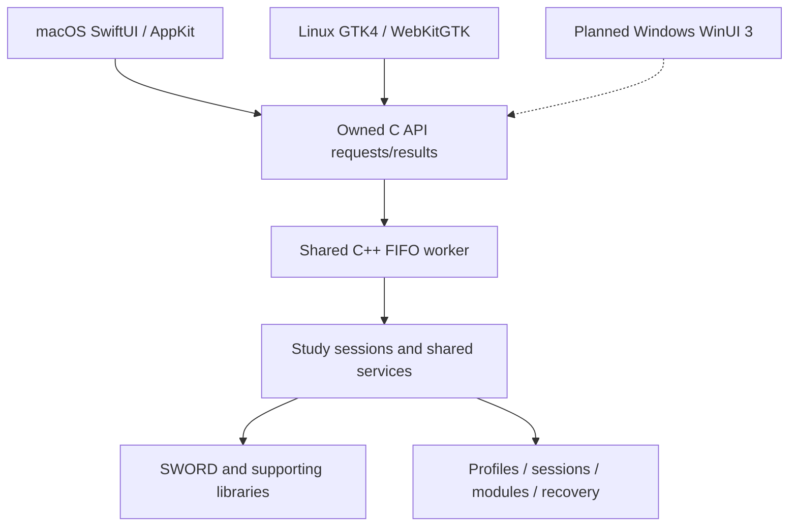

# Current architecture

Updated 2026-11-05. The GTK3 application is retired; its original source is in
Git history and selected behavior oracles are in src/core/tests/legacy-reference.

## Boundaries

- src/core owns study/navigation/history, content and search, parallel alignment,
  bookmarks/annotations, editing, library/installation, storage and recovery.
- One SWORD-owning worker serializes operations. Native hosts await requests and
  consume owned/copied results; they do not retain SDK pointers or build another engine.
- C11 handles provide explicit ownership and take-once results. C++17 owns native
  services; retained policy helpers remain C++11-compatible. Mac adapters use Swift6.
- Host metadata records presentation such as frames and native tab groups, while
  canonical study/session state stays in the shared services.
- Staged writes use revision checks and pre-publication cancellation gates.
  SDK work without safe interruption drains before staging is discarded.

## Current services and contracts

[Study/session persistence](session-persistence.md), [parallel reading](parallel-reading-workflows.md),
[search](search-workflows.md), [library/installation](library-installation.md),
[recovery management](native-recovery-management.md), [legacy migration](legacy-assets-migration.md),
[localized reading](localized-reading-verification.md) and
[runtime packaging](native-runtime-packaging.md) describe bounded contracts and evidence.

Localization lives in localization/: exact gettext imports and overrides generate
native resources. Private SWORD locale objects translate selector labels without
changing canonical targets or global locale. RTL direction comes from actual modules.
BibleSync shares passage navigation; personal data synchronization is separate future work.

## Dependencies and platforms

[Dependency inventory](../../dependencies/README.md) and platform CMake/tooling are
authoritative for build requirements. No GTK library is required by the base core.
GLib remains a Unicode/runtime dependency. Windows WinUI3 is not implemented;
Mac/Linux interfaces and all platform releases still have acceptance gaps.

The local Graphify map is an analysis aid, not an authoritative call graph.
Its inferred edges require source verification; generated output stays untracked.
[Historical architecture/extraction notes](history/architecture.md) preserve former GTK relationships.
